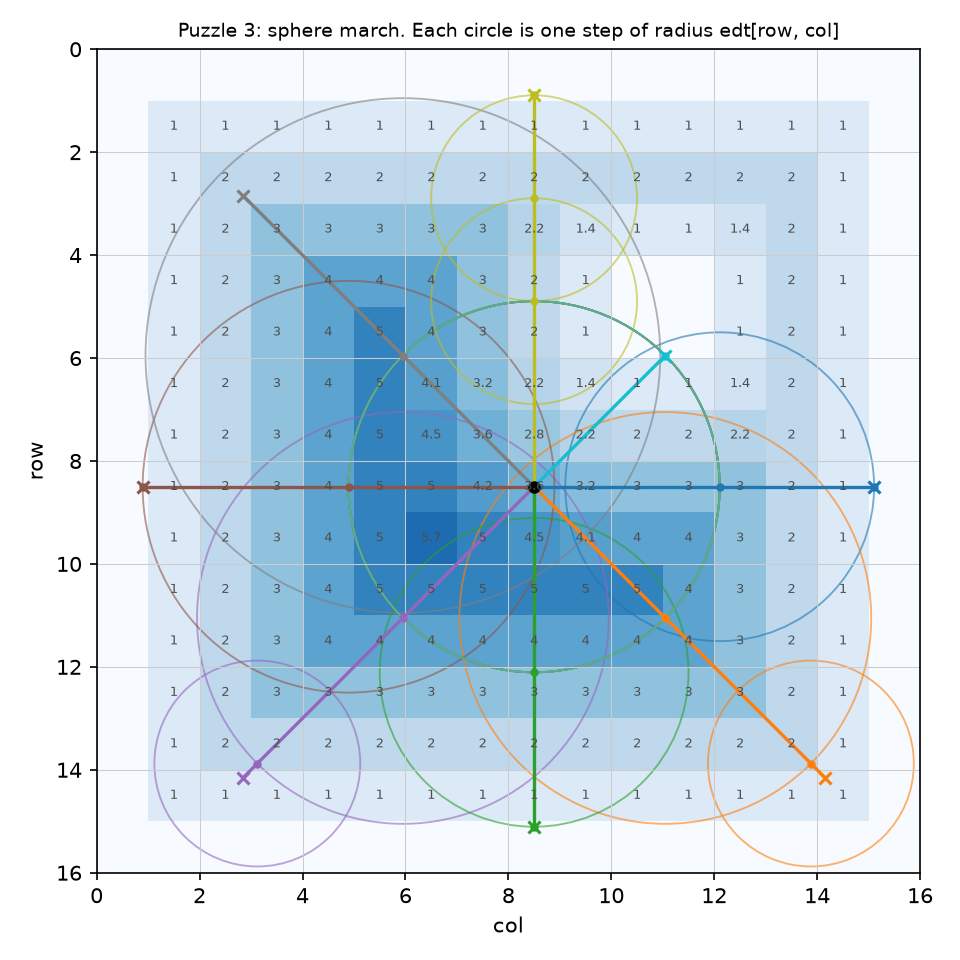
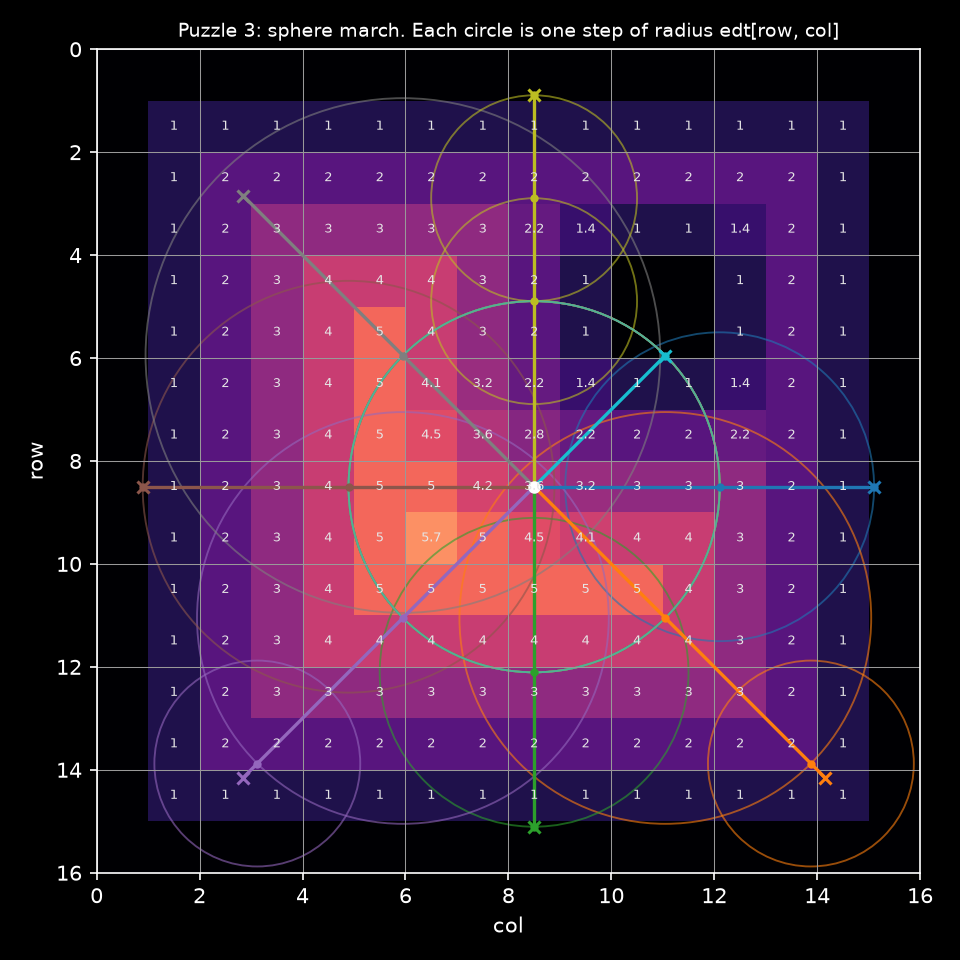

# Puzzle 3: Sphere March

## Overview

Implement `raycast`, a Warp function that marches a ray through the distance
field until it hits a wall, leaves the map, or has travelled `max_px`, and
returns the distance it covered in pixels. The kernel `march` that calls it once
per ray is written for you.

**Note:** _You have 1 thread per ray. Each thread loops, and how many times
depends on the geometry in front of it._




## Key concepts

In this puzzle, you'll learn about:

- Device functions with `@wp.func`, callable from kernels, with a typed return
- `while` loops with a data-dependent trip count
- Declaring a mutable float: `dist = float(0.0)`
- `break` on a wall or a map edge
- `wp.vec2` as a 2D vector: `p += d * step` moves both coordinates

### The algorithm

The sample point \\(p\\) is a pixel coordinate `(col, row)`, so `p[0]`
indexes columns and `p[1]` rows, and `edt[wp.int32(p[1]), wp.int32(p[0])]` is the
distance from the sample to the nearest wall. No wall can be closer than that
in any direction, so the ray can jump exactly that far without passing through
one:

\\[\Large step = edt\big[\lfloor p[1] \rfloor, \lfloor p[0] \rfloor\big]\\]

\\[\Large p \leftarrow p + step \cdot d \qquad dist \leftarrow dist + step\\]

Repeat until the sample lands on a wall pixel (`step == 0`), leaves the raster,
or `dist` reaches `max_px`, and return `min(dist, max_px)`. In open space the
steps are large and shrink only as the ray closes in on something. The figure
draws each step as a circle of radius `step`: every circle touches the nearest
wall and contains none.

Two details:

- Test the bounds **before** reading `edt`: a sample outside the raster has no
  distance to read
- The loop condition is checked before a step, not after, so the last step can
  carry `dist` past `max_px`; the `wp.min` at the return is what makes a capped
  ray report exactly the cap

### Memory access pattern

```txt
Thread 0 (ray right):  edt[8, 8] -> edt[8, 12] -> edt[8, 15] (wall)         3 reads
Thread 7 (ray up-right): edt[8, 8] -> edt[5, 11] (pillar)                   2 reads
Thread 1 (ray down-right): edt[8, 8] -> edt[11, 11] -> edt[13, 13] -> capped 3 reads
```

Which pixel a thread reads next depends on the value it just read. Nothing here
can be prefetched or coalesced ahead of time; the only thing the hardware can
do is keep many rays in flight at once.

## Configuration

- Map: a `16 x 16` px room with a 1 px wall and a `2 x 2` px pillar at rows
  4–5, columns 10–11
- Rays: `NUM_RAYS = 8`, all from the centre of pixel `(8, 8)`, one every 45°
- `MAX_PX = 8.0`: a ray that reaches this far reports exactly 8

## Code to complete

```python
{{#include ../../../problems/p03/p03.py:raycast}}
```

<a href="{{#include ../_includes/repo_url.md}}/blob/main/problems/p03/p03.py" class="filename">View full file: problems/p03/p03.py</a>

<details>
<summary><strong>Tips</strong></summary>

<div class="solution-tips">

1. Loop `while dist < max_px:`
2. `col = wp.int32(p[0])` and `row = wp.int32(p[1])`
3. `break` if `col` is outside `[0, edt.shape[1])` or `row` outside
   `[0, edt.shape[0])`
4. `step = edt[row, col]`, and `break` if it is `0.0`
5. Advance: `p += d * step` and `dist += step`
6. The `return wp.min(dist, max_px)` is already there

</div>
</details>

## Running the code

To test your solution, run the following command in your terminal:

```bash
uv run python problems/p03/p03.py
```

Your output will look like this if the puzzle isn't solved yet:

```txt
out: [0. 0. 0. 0. 0. 0. 0. 0.]
expected: [6.6055512 8.        6.6055512 8.        7.6055512 8.        7.6055512
 3.6055512]
```

## Solution

<details class="solution-details">
<summary></summary>

```python
{{#include ../../../solutions/p03/p03.py:raycast_solution}}
```

<div class="solution-explanation">

This is warporacer's `raycast` with one map instead of a stack. Following
three of the rays from the centre of pixel `(8, 8)`, so `p = (8.5, 8.5)`:

**Ray 0, pointing right along +col:**

```txt
edt[8, 8]  = 3.606   (the pillar corner at (5, 10) is closer than any wall: sqrt(3^2 + 2^2))
p = (12.11, 8.5), dist = 3.606
edt[8, 12] = 3.0     (the right wall)
p = (15.11, 8.5), dist = 6.606
edt[8, 15] = 0       -> wall, stop. Reports 6.606
```

**Ray 7, pointing up-right toward the pillar:**

```txt
edt[8, 8]  = 3.606
p = (11.05, 5.95), dist = 3.606
edt[5, 11] = 0       -> the pillar, stop after one step. Reports 3.606
```

**Ray 1, pointing down-right toward the far corner:**

```txt
edt[8, 8]   = 3.606 -> p = (11.05, 11.05), dist = 3.606
edt[11, 11] = 4.0   -> p = (13.88, 13.88), dist = 7.606
edt[13, 13] = 2.0   -> p = (15.30, 15.30), dist = 9.606
dist >= max_px, loop ends. Reports min(9.606, 8) = 8
```

Notice the last case: the loop condition is checked before each step, not
after, so the final step is allowed to carry `dist` past `max_px`. The
`wp.min` at the return is what makes a capped ray report exactly the cap, which
is what the lidar needs (a beam that sees nothing within 20 m reports 20 m).

### Where the 0.106 comes from

Ray 0 reports 6.606 px, yet the wall it hits, column 15, begins 6.5 px from
the start at 8.5. The field is measured between pixel centres: from the centre
of pixel (8, 12) the nearest wall pixel's centre is 3 px away, so from 12.106 a
step of 3 lands at 15.106, a tenth of a pixel inside the wall pixel. A sphere
march always stops inside the wall pixel, never on its boundary, and from an
arbitrary point in a pixel it can land up to a pixel past the edge. warporacer
lives with this: a pixel is 5 cm on a real track, the car itself is 42 × 58 cm,
and the training randomises far bigger things than that every episode.

### Why the pillar matters

Without it, `edt[8, 8]` would be 7 and ray 0 would reach the wall in one step.
Real tracks are all pillar: the distance field in a corridor is the distance to
the nearer wall, and a ray down the corridor takes a few medium steps rather
than one big one. That step count, around 5 to 20 on the F1TENTH maps, is what
the lidar kernel's cost comes down to.

</div>
</details>
