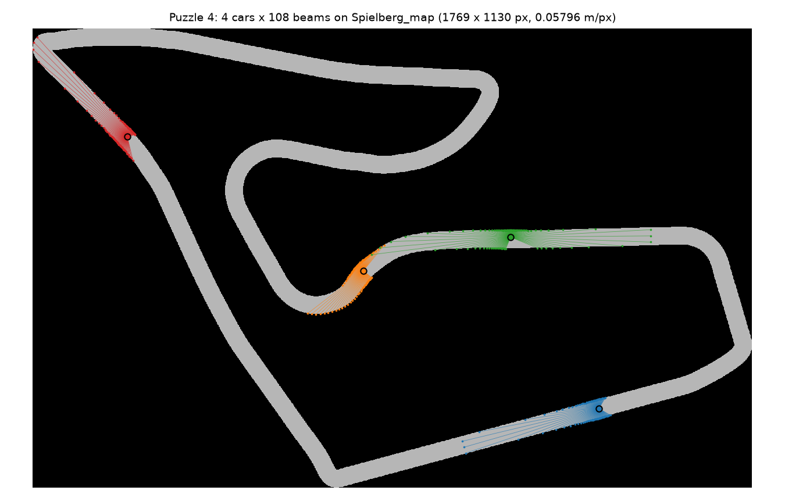
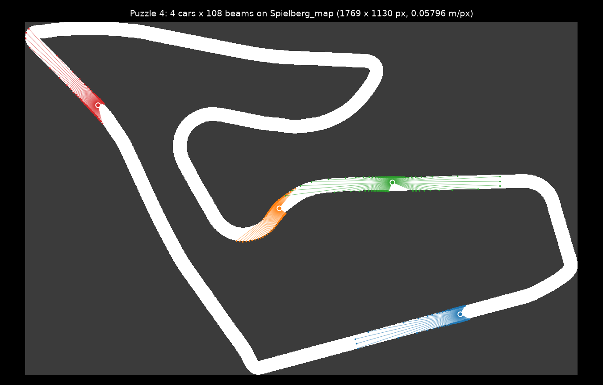

# Puzzle 4: Lidar

## Overview

Implement the lidar kernel: one thread per (car, beam) that shoots a ray from
the car's laser mount, in the beam's direction rotated by the car's heading, and
writes the range in meters into `scan[i, j]`. This is warporacer's
`lidar_kernel` on a single map, run on the Spielberg track with 4 cars and 108
beams.

**Note:** _You have a 2D launch: `i, j = wp.tid()` gives the car and the beam._




## Key concepts

In this puzzle, you'll learn about:

- 2D launches: `wp.launch(..., dim=(NUM_CARS, NUM_LIDAR))` and
  `i, j = wp.tid()`
- Arrays of vectors: `wp.array(dtype=wp.vec2)`, indexed `lidar_dirs[j]`, then
  `[0]` and `[1]` for the components
- Rotating a direction into the heading frame, and the sign flip the row axis
  introduces
- Composing what you have: the pixel transform from Puzzle 2 and `raycast` from
  Puzzle 3

For car \\(i\\) at \\((x_i, y_i)\\) with heading \\(\psi_i\\), and beam \\(j\\)
with unit direction \\((b_x, b_y)\\) in the car frame, the ray starts at the
pixel

\\[\Large p = \begin{pmatrix} (x_i + m \cos\psi_i - o_x) / res \\\\ (H - 1) - (y_i + m \sin\psi_i - o_y) / res \end{pmatrix}\\]

and points along

\\[\Large d = \begin{pmatrix} \cos\psi_i \cdot b_x - \sin\psi_i \cdot b_y \\\\ -(\sin\psi_i \cdot b_x + \cos\psi_i \cdot b_y) \end{pmatrix}\\]

\\[\Large scan[i, j] = raycast(edt, p, d, R / res) \times res\\]

The first is Puzzle 2's world-to-pixel transform without the floor and the
clamp, applied to the laser mount instead of the car's centre; the second is
the beam rotated by the heading, with its row component negated.

| in the formula | in the code | meaning |
|---|---|---|
| \\(x_i, y_i, \psi_i\\) | `cars[i, 0]`, `cars[i, 1]`, `cars[i, 2]` | the car's world position and heading |
| \\(\cos\psi_i, \sin\psi_i\\) | `ch`, `sh` | computed once per thread |
| \\(m\\) | `LIDAR_MOUNT_X` | the laser mount, 0.2733 m ahead of the car's centre |
| \\(b_x, b_y\\) | `lidar_dirs[j][0]`, `lidar_dirs[j][1]` | beam \\(j\\)'s unit direction in the car frame |
| \\(o_x, o_y\\), \\(res\\), \\(H\\) | `ox`, `oy`, `res`, `edt.shape[0]` | the map, as in Puzzle 2 |
| \\(R\\) | `LIDAR_RANGE` | the lidar range, 20 m |
| \\(p, d\\) | `p`, `d` | `raycast`'s start pixel and unit direction from Puzzle 3 |

### The two frames

The beam directions are unit vectors in the car frame (\\(x\\) forward,
\\(y\\) left), spread over a 270° fan centred on the car's nose: beam
\\(j\\) points at \\(\theta_j = -135^\circ + 270^\circ \cdot j / 107\\), so
\\((b_x, b_y) = (\cos\theta_j, \sin\theta_j)\\), with beam 0 pointing to the
car's right-rear and beam 107 to its left-rear. Rotating by \\(\psi_i\\) takes
a beam into the world frame. The raster's row axis points the opposite way to
world \\(y\\), so the row component of the direction is negated: that is the
minus sign on the second row of \\(d\\). And the ray starts at the laser, not
the car centre: `LIDAR_MOUNT_X` ahead of `base_link` along the heading.

### Launch order

In a 2D launch the second index varies fastest, so consecutive threads are
consecutive beams of the same car. Their rays start at the same pixel and fan
out, so early in the march they read the same cache lines. That matters in
Puzzle 6.

## Configuration

- Map: `maps/Spielberg_map.yaml`, 1130 × 1769 px at 0.05796 m/px (an F1TENTH
  racetrack)
- Cars: `NUM_CARS = 4`, spawned at random drivable pixels at least 0.5 m from a
  wall, with random headings
- Beams: `NUM_LIDAR = 108` over `LIDAR_FOV = 270°`, `LIDAR_RANGE = 20` m, mount
  offset `LIDAR_MOUNT_X = 0.2733` m
- Output: `scan` of shape `(NUM_CARS, NUM_LIDAR)`, in meters
- Check: within one pixel of a NumPy float32 reference (exact on CPU)

Notes:

- **Map loading** is `harness.track.Track`: the image thresholded at 230,
  through SciPy's `distance_transform_edt`. It is warporacer's loader minus the
  centerline extraction, and the same file the Mojo twin drives through
  Python interop
- **Beam directions** are built in NumPy, `NUM_LIDAR` angles evenly spaced
  over `LIDAR_FOV` with `np.linspace`, and passed as `(cos, sin)` pairs in a
  `wp.array(dtype=wp.vec2)`
- `raycast` is Puzzle 3's solution, unchanged; it's in the listing so you can
  see its signature

## Code to complete

```python
{{#include ../../../problems/p04/p04.py:lidar}}
```

<a href="{{#include ../_includes/repo_url.md}}/blob/main/problems/p04/p04.py" class="filename">View full file: problems/p04/p04.py</a>

<details>
<summary><strong>Tips</strong></summary>

<div class="solution-tips">

1. Start point: add `LIDAR_MOUNT_X * ch` to `x` and `LIDAR_MOUNT_X * sh` to
   `y`, then apply Puzzle 2's world-to-pixel transform. No clamp this time;
   `raycast` handles rays that leave the map
2. Direction: rotate `lidar_dirs[j]` by `(ch, sh)` and negate the row component
3. Range: `raycast(edt, p, d, LIDAR_RANGE / res)` returns pixels; multiply by
   `res` for meters

</div>
</details>

## Running the code

To test your solution, run the following command in your terminal:

```bash
uv run python problems/p04/p04.py
```

Your output will look like this if the puzzle isn't solved yet:

```txt
map: Spielberg_map (1130 x 1769 px, 0.05796 m/px)
car 0 pose (x, y, psi): [ -3.9124591 -24.971817   -2.8841484]
out (car 0, every 18th beam): [0. 0. 0. 0. 0. 0.]
expected: [ 1.8487979  1.2861104  1.7497904 20.         1.8376681  1.3440704]
max |out - expected|: 2.00e+01 m
```

and like this once it is:

```txt
map: Spielberg_map (1130 x 1769 px, 0.05796 m/px)
car 0 pose (x, y, psi): [ -3.9124591 -24.971817   -2.8841484]
out (car 0, every 18th beam): [ 1.8487979  1.2861104  1.7497904 20.         1.8376681  1.3440704]
expected: [ 1.8487979  1.2861104  1.7497904 20.         1.8376681  1.3440704]
max |out - expected|: 0.00e+00 m
Puzzle 04 complete ✅
```

## Solution

<details class="solution-details">
<summary></summary>

```python
{{#include ../../../solutions/p04/p04.py:lidar_solution}}
```

<div class="solution-explanation">

This solution, per thread:

1. **Start point** `p`: the laser mount in world coordinates,
   `(x + LIDAR_MOUNT_X * ch, y + LIDAR_MOUNT_X * sh)`, pushed through the
   Puzzle 2 transform. The row uses `float(edt.shape[0] - 1) - ...` for the flip.
   There is no clamp because `raycast` breaks out as soon as a sample leaves
   the raster
2. **Direction** `d`: the beam `(bx, by) = lidar_dirs[j]` rotated by the
   heading, `(ch * bx - sh * by, sh * bx + ch * by)`, with the second component
   negated so that "up" in the world is "toward row 0" in the raster
3. **Range**: `raycast` works in pixels, so the maximum is `LIDAR_RANGE / res`
   and the result is multiplied back by `res`

Car 0's fourth sampled beam reports exactly `20.0`: it ran the full range down
a straight without touching anything, which is `wp.min(dist, max_px)` doing its
job from Puzzle 3.

The check is `atol=track.res`, one pixel. On CPU the kernel and the NumPy
reference are bit-identical, as the `0.00e+00` shows. On CUDA the compiler fuses
multiply-adds, which can move a sample by an ulp, and a sample an ulp from a
pixel boundary can land in the neighbouring pixel. That changes the reported
range by at most one step, and the last step before a wall is about one pixel.

</div>
</details>
